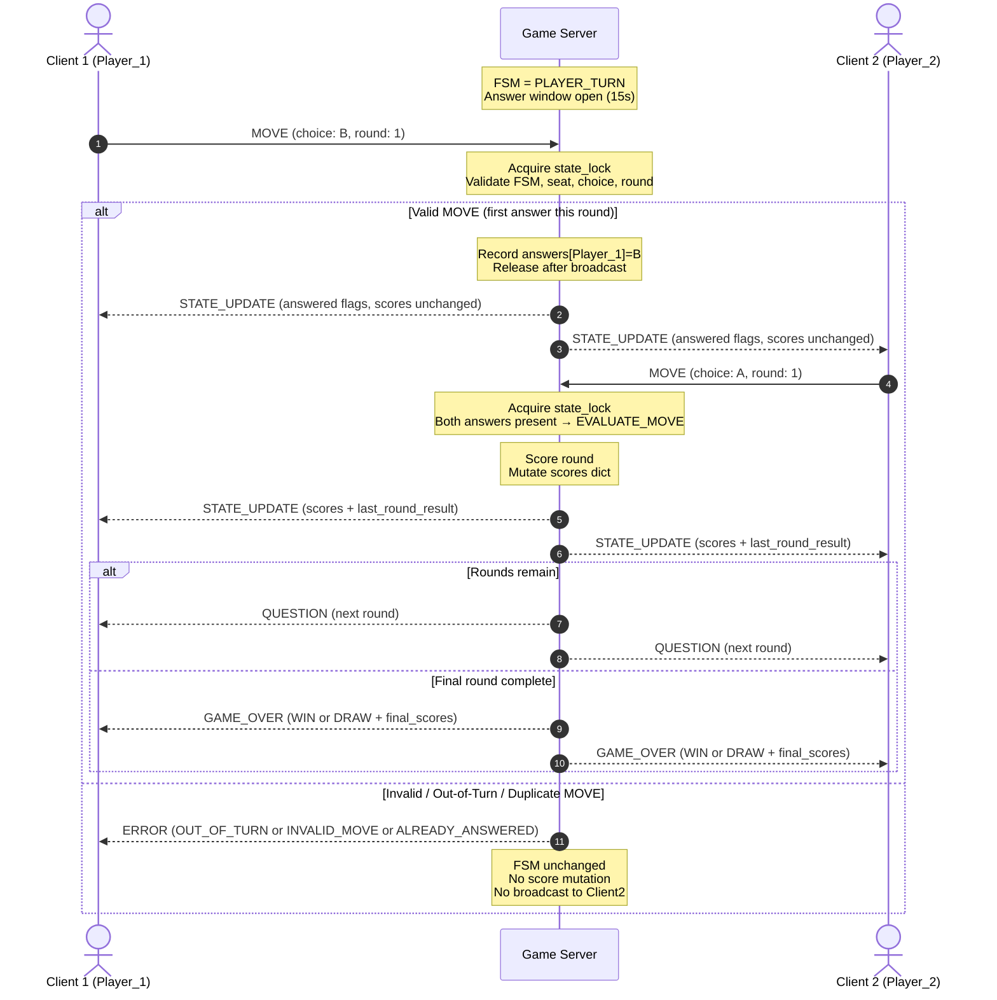

# Server Concurrency & Game Behavior Architecture — Terminal Trivia

**Student:** Ben Schlicting  
**Course:** CS 457 – Computer Networks  
**Sprint:** 2 — Game Behavior & Server Concurrency Architecture Design  
**Aligned specs:** [`protocol_blueprint.md`](protocol_blueprint.md), [`fsm_specification.md`](fsm_specification.md)

---

## 1. Architecture Choice

**Selected model: Option A — Multi-Threading (`threading.Thread`)**

| Decision | Detail |
|---|---|
| Pattern | One dedicated worker thread per accepted client TCP socket |
| Accept loop | Main thread owns the listening socket and spawns workers |
| Shared state | Protected by a single reentrant `threading.RLock` (`state_lock`) |
| Why not Option B | Terminal Trivia needs a **15-second answer window** with simultaneous `MOVE`s from both players. Per-client blocking `recv()` in worker threads keeps framing buffers simple; a timer thread wakes the match when the window expires. `selectors` would work, but forces a single-threaded event loop to multiplex framing, timeouts, and FSM transitions — more complex for a 2-player game with no need for thousands of sockets. |

### 1.1 Capacity Plan

| Resource | Limit / Plan |
|---|---|
| Active match seats | Exactly **2** (`Player_1`, `Player_2`) |
| Concurrent TCP clients | Accept ≤ 2 seated players; reject 3rd+ with `ERROR` (`ROOM_FULL`) then close |
| Worker threads | 1 acceptor thread + 1 worker per connected client (≤ 2 during a match) + 1 optional round-timer thread |
| Matches per process | One match at a time; after `CLEANUP` the server returns to `INIT` and accepts the next pair |

Two simultaneous client connections are serviced without blocking the listening accept loop: `accept()` continues on the main thread while existing workers block on their own sockets.

---

## 2. Connection Lifecycle

```text
[Main Thread]
  bind(0.0.0.0, PORT) → listen()
  loop:
    conn, addr = accept()
    spawn ClientWorker(conn) as daemon thread

[ClientWorker Thread — per socket]
  register empty recv buffer
  loop:
    data = conn.recv(4096)
    if data == b"": handle_disconnect(); break
    append to buffer; split on "\n"; json.loads each line; dispatch(msg)
  finally:
    teardown_socket(); unregister from client list
```

### 2.1 Lifecycle Stages

| Stage | Owner | Actions |
|---|---|---|
| **Listen** | Main thread | Create TCP socket, `SO_REUSEADDR`, `bind`, `listen`. FSM = `INIT` → `WAITING_FOR_PLAYERS`. |
| **Accept** | Main thread | `accept()` returns a connected socket; spawn `ClientWorker` immediately so the accept loop never blocks on client I/O. |
| **Register** | Worker (under `state_lock`) | On valid `CONNECT`: seat player, assign role (`Player_1` / `Player_2`), store `{role → socket, display_name, recv_buffer}`. First player gets `LOBBY_WAIT`; second triggers `GAME_START`. |
| **Active game loop** | Workers + timer | Workers parse framed JSON and call FSM handlers under `state_lock`. Round timer thread signals window expiry → `EVALUATE_MOVE`. Workers also send outbound frames (`QUESTION`, `STATE_UPDATE`, etc.) under the lock so broadcast order is deterministic. |
| **Teardown** | Worker / `CLEANUP` | Close client socket, remove seat, clear buffer. Match-active disconnect → forfeit `GAME_OVER` → `CLEANUP` → `INIT`. Listening socket stays open across matches. |

### 2.2 Thread Roles

```text
┌─────────────────┐     accept()      ┌──────────────────┐
│  Main / Accept  │ ───────────────►  │ ClientWorker P1  │◄── TCP Client 1
│     Thread      │                   └────────┬─────────┘
└─────────────────┘                            │
        │                     ┌────────────────┼────────────────┐
        │ accept()            │   state_lock   │  shared FSM    │
        ▼                     │  scores, seats,│  round, answers│
┌──────────────────┐          └────────────────┼────────────────┘
│ ClientWorker P2  │◄──────────────────────────┘
└────────┬─────────┘
         │
┌────────▼─────────┐
│  RoundTimer      │  (daemon; started each PLAYER_TURN)
│  Thread (15s)    │──► acquire state_lock → force EVALUATE_MOVE if needed
└──────────────────┘
```

---

## 3. Shared Resources & Thread Safety

### 3.1 Shared Mutable State

| Resource | Type (conceptual) | Why shared | Protected by |
|---|---|---|---|
| `clients` | `dict[role → ClientSession]` | Workers register/unregister; broadcasts iterate sockets | `state_lock` |
| `fsm_state` | enum / str | All dispatch paths mutate FSM | `state_lock` |
| `current_round` | `int` | MOVE validation + QUESTION payloads | `state_lock` |
| `answers` | `dict[role → choice \| None]` | Simultaneous MOVE writes from both workers | `state_lock` |
| `scores` | `dict[role → int]` | Updated in `EVALUATE_MOVE`; read for broadcasts | `state_lock` |
| `question_bank` / `correct_answers` | list / dict | Read-only after load at match start | load once under lock; treat as immutable thereafter |
| `round_deadline` | `float` (monotonic) | Timer + MOVE path both observe window | `state_lock` |
| Per-socket `recv_buffer` | `bytearray` | **Not** shared — owned exclusively by that worker | thread-local / session-private |

There is **no client-owned board**. The “board” analogue for Terminal Trivia is `answers` + `scores` + `current_round` on the server.

### 3.2 Lock Strategy

- **Primary lock:** `state_lock = threading.RLock()`
- **Why `RLock`:** FSM helpers may call `broadcast()` while already holding the lock; reentrancy avoids self-deadlock.
- **Rule:** Any read or write of shared match state, and any multi-client send that must be atomic with that mutation, happens **inside** `with state_lock:`.
- **I/O exception:** `conn.recv()` runs **outside** the lock so one slow client cannot stall the other worker or the timer. After bytes arrive, parsing and dispatch re-acquire the lock.

### 3.3 Critical Sections (Acquire / Release Patterns)

```python
# Pattern A — seat a connecting client
with state_lock:
    if seated_count >= 2:
        send_error(sock, "ROOM_FULL", recoverable=False)
        # release happens via context manager, then close socket outside
    else:
        seat_player(sock, display_name)
        if seated_count == 1:
            send_line(sock, lobby_wait_msg)
        elif seated_count == 2:
            enter_game_start()   # may call broadcast() while still holding lock

# Pattern B — validate and record a MOVE (called from either worker)
with state_lock:
    if fsm_state != "PLAYER_TURN":
        send_error(sock, "OUT_OF_TURN", recoverable=True)
        return
    if answers[role] is not None:
        send_error(sock, "ALREADY_ANSWERED", recoverable=True)
        return
    if choice not in {"A", "B", "C", "D"}:
        send_error(sock, "INVALID_MOVE", recoverable=True)
        return
    if round_field != current_round:
        send_error(sock, "STALE_ROUND", recoverable=True)
        return
    answers[role] = choice
    broadcast(state_update_answered_flags())  # both clients see who answered
    if answers[P1] is not None and answers[P2] is not None:
        evaluate_move()  # score → STATE_UPDATE → next QUESTION or GAME_OVER

# Pattern C — round timer expiry
with state_lock:
    if fsm_state == "PLAYER_TURN" and time.monotonic() >= round_deadline:
        evaluate_move()  # missing answers scored as incorrect

# Pattern D — disconnect / forfeit
with state_lock:
    mark_disconnected(role)
    if fsm_state in {"GAME_START", "PLAYER_TURN", "EVALUATE_MOVE"}:
        broadcast(game_over_forfeit(winner=opponent))
        cleanup_match()
```

**Deadlock avoidance:** Never acquire a second lock. Never call `recv()` while holding `state_lock`. Keep critical sections short (validate → mutate → `send` framed lines → return).

### 3.4 Race Conditions Prevented

| Race | Without lock | With lock |
|---|---|---|
| Both players `MOVE` at once | Double-write / lost answer / premature score | Serialized; each answer recorded once |
| Timer fires while last `MOVE` arrives | Double `EVALUATE_MOVE` / double score | Second entry sees FSM already left `PLAYER_TURN` and no-ops |
| Broadcast while peer disconnects | Iterate mutating `clients` | Remove under lock; broadcast snapshot of sockets |
| Third client joins mid-match | Corrupt seat table | `ROOM_FULL` under lock |

---

## 4. Turn Enforcement & Answer-Window Semantics

Terminal Trivia is **simultaneous** within a round: both seats may legally send one `MOVE` while `fsm_state == PLAYER_TURN`.

| Check | Error code | Effect on FSM |
|---|---|---|
| Not in `PLAYER_TURN` | `OUT_OF_TURN` | Stay; no score change |
| Duplicate answer same round | `ALREADY_ANSWERED` | Stay |
| Bad choice / types | `INVALID_MOVE` | Stay |
| Wrong `round` field | `STALE_ROUND` | Stay |
| Malformed JSON | `MALFORMED` | Stay |
| Valid first answer | *(none)* | Record; optional `STATE_UPDATE` with `answered` flags |
| Both answered **or** 15s timeout | *(none)* | → `EVALUATE_MOVE` |

Invalid / out-of-turn moves **never** advance scoring and **never** crash the worker loop.

---

## 5. Score & Leaderboard Synchronization

### 5.1 In-Memory Score Store

```text
scores = {"Player_1": 0, "Player_2": 0}          # running totals
answers = {"Player_1": None, "Player_2": None}    # per-round choices
current_round: int                                # 1..10
total_rounds = 10
```

Authoritative correct answers live only on the server (never sent in `QUESTION`).

### 5.2 Broadcast Logic (`EVALUATE_MOVE`)

Under `state_lock`:

1. Compare each recorded choice to the correct answer; award `+1` or `0`.
2. Build one `STATE_UPDATE` payload with `scores`, `last_round_result`, `answered`, `status: "round_complete"`.
3. **Synchronous fan-out:** iterate seated sockets and `sendall` the same framed JSON line to **both** clients before releasing the lock (or before changing FSM further).
4. If `current_round < 10`: increment round, clear `answers`, broadcast next `QUESTION`, return to `PLAYER_TURN`.
5. Else: compare totals → `GAME_OVER` (`WIN` / `DRAW`) → `CLEANUP`.

Both clients therefore render the same scoreboard from the same server-authored frame; clients never invent scores.

---

## 6. Mermaid Sequence Diagram — MOVE Validation & Broadcast

Happy path plus rejection branches for out-of-turn / invalid moves. Simultaneous play is shown with Player 1 answering first, then Player 2 completing the round.



### 6.1 Narrative (Round-Trip Flow)

1. **Client → Server:** Worker for Client 1 receives a newline-framed `MOVE`.
2. **Validate under lock:** Confirm `PLAYER_TURN`, matching `round`, legal `choice`, and that this seat has not already answered.
3. **Mutate or reject:** On success, write `answers[role]`; on failure, send `ERROR` only to the offending client and leave shared scores untouched.
4. **Partial sync:** After the first valid answer, broadcast a lightweight `STATE_UPDATE` so both terminals show who has answered.
5. **Full sync:** When both answers exist (or the timer expires), `EVALUATE_MOVE` mutates `scores` and synchronously broadcasts the same `STATE_UPDATE` (and next `QUESTION` or `GAME_OVER`) to **all** connected clients before unlocking.

---

## 7. Disconnect Paths (Concurrency Notes)

| Event | Detection | Locked handling |
|---|---|---|
| Graceful `DISCONNECT` msg | Worker dispatch | Forfeit if match active; else clear lobby seat |
| TCP FIN (`recv` → `b""`) | Worker I/O loop | Same as application disconnect |
| RST / `ConnectionResetError` | Worker exception | Same forfeit / cleanup path |
| Peer send failure during broadcast | `sendall` exception | Mark dead, continue to remaining client, then cleanup |

Workers never leave shared structures half-updated: seat removal and FSM forfeit transitions are atomic under `state_lock`.

---

## 8. Acceptance Checklist (Sprint 2)

- [x] Concurrency model chosen and documented: **multi-threading** with one worker per client socket
- [x] Connection lifecycle covered: listen → accept → register → game loop → teardown
- [x] Supports ≥ 2 simultaneous clients without blocking the accept loop
- [x] Shared resources listed; `threading.RLock` critical sections specified
- [x] Turn / answer-window enforcement prevents illegal moves from corrupting scores
- [x] Score store + dual-client `STATE_UPDATE` broadcast logic described
- [x] Mermaid `sequenceDiagram` embedded (valid / invalid `alt` branches, dual broadcast)
- [x] Deliverable is Markdown under `docs/` (no PDF)

---

## 9. Implementation Pointers (Sprint 3)

Pseudo-structure only — coding happens in Sprint 3:

```text
server.py
  main(): accept loop → ClientWorker(conn).start()
  ClientWorker.run(): recv/frame/dispatch
  MatchEngine (locked): CONNECT / MOVE / DISCONNECT / timer_fire
  broadcast(msg): for each seated sock → send framed JSON
```

All message schemas and FSM states must continue to match `protocol_blueprint.md` and `fsm_specification.md`.
